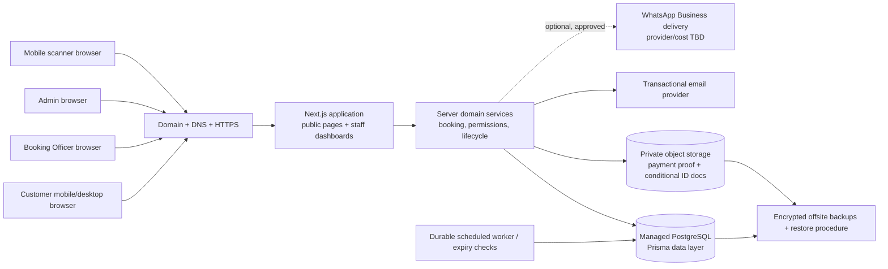

# Technical architecture proposal

**Status:** design proposal; no provider, paid service or production account is selected. The later Master Build Prompt separately authorizes local implementation and local testing; production deployment and external connections remain prohibited. This proposal follows approved requirements in documents 00–15 as clarified by that newer prompt.

## Recommendation

Keep the documented Next.js + TypeScript + Prisma + PostgreSQL direction for now. Use one server-rendered web application with server-side route handlers/domain services, and one PostgreSQL source of truth. Prefer managed deployment and database for an owner who should not administer Linux, but the verified entry prices exceed the $100/year total budget; document 20 compares alternatives. Do not switch frameworks or database solely to pursue free tiers: free offerings inspected have production limitations or commercial-use restrictions.

The present project has Next.js App Router source directories, `package.json` declaring Next.js 16, TypeScript, Prisma 7 and PostgreSQL adapter, and a placeholder `prisma/schema.prisma` with no application entities. There is no database URL configured here, no auth, no API, no storage, no payment, no scanner and no deployment. The foundation is appropriate for detailed design; nothing proves that booking system features already exist.

## Component map

## Components and status

| Component | Status | Design |
|---|---|---|
| Public site | Essential | Arabic RTL responsive customer flow for the one configured play and fixed performances; 1–9 seats per online booking, private tracking link. |
| Admin dashboard | Essential | Review InstaPay proof, manage show data, roster, refunds, invitations, users, reports/export, audit. Server enforces Admin permissions. |
| Booking Officer dashboard | Essential | Individual account, group booking from 10 tickets, own Cash receipt, uploads group proof, views all bookings/reports/financials but cannot export or modify another officer's booking absent Admin permission. |
| PostgreSQL | Essential | Relational authoritative state for seats, holds, bookings, proof decisions, tickets, permissions, audit and refunds. Use transactions/constraints for concurrent operations. |
| Private object storage | Essential before collecting proof/docs | Private files, short-lived authorized access, server-side metadata and audited access. Must complete legal/privacy and region review before ID collection. |
| QR generation | Essential | Create a per-ordinary-ticket opaque unique QR token; separate VIP invitation credential. QR library choice deferred to implementation planning. |
| Scanner | Essential | Mobile browser, camera, internet, server validation, atomic ordinary-ticket redemption, immediate cross-device result; no offline mode. |
| Email delivery | Optional channel selected by customer/group/VIP recipient | Transactional email for tickets/tracking as opted into. Provider and costs remain open. |
| WhatsApp delivery | Optional channel selected by customer/group/VIP recipient | Automated Business Platform may involve provider/per-message charges and templates. Manual fallback to be documented. Do not assume personal WhatsApp automation is permitted/free. |
| Payment proof | Essential | Upload InstaPay transfer evidence; only Admin/Super Admin can confirm. No automatic InstaPay integration assumed. |
| Durable timer processing | Essential | Expire online holds only before timely proof submission; never expire online Pending Admin Review. Group timer pauses only for requested discount/comp review and resumes remaining duration. Worker uses database state, not machine-local timers. |
| Monitoring | Essential at launch | Uptime, job failures, storage/DB capacity, email delivery, and proof-review backlog/age. Provider and budget open. |
| Background job/queue service | Optional implementation choice | Could use scheduled server job/managed queue if hosting lacks reliable cron. Must not introduce Redis/another paid service without cost/approval. |
| SMS/OTP | Deferred/out of scope | Owner rejected SMS/WhatsApp OTP. |
| Offline scanning | Deferred/out of scope | Venue internet is available; fail closed when server cannot validate. |
| Automated payment gateway | Deferred | Current online and group InstaPay requirement is proof upload plus Admin review; any future verified automation requires separate approval. |

## Application responsibilities

Use a modular monolith initially: public pages and staff dashboards in Next.js, with server-side domain functions for seat availability, atomic holds, timer state, proof decisions, ticket issuance, refunds, scans and audit. Keep permission checks and totals on the server. Do not let browser state or a return page decide payment or ticket validity.

Prisma maps domain data to PostgreSQL. Important concurrency actions must use transactions and a DB-enforced unique active `(performance, seat)` allocation. Timer jobs re-read and conditionally update current state. A timely online proof upload changes state before the expiry transaction can release seats; the review state has no automatic deadline.

## File and credential flow

Browser uploads proof/document through a protected server-authorized flow to private storage; database stores object key, size/type/hash, uploader, submission/decision timestamps and retention status, never a public URL. Signed access should be short-lived and issued only after role checks. Exact role access and whether an upload gateway/direct signed URL is used require technical/security review.

Tracking links and QR tokens are independent high-entropy credentials stored as hashes where feasible. The customer link reveals one booking only and must be revocable. Ordinary ticket QR is unique and single-use. VIP invitation QR can be reused across different performances and logs each use; same-performance behavior remains open.

## Deployment and recovery

Source/config remain in Git and portable. Hosting serves the Next.js server application; managed PostgreSQL is private/restricted. Secrets live in deployment secret settings, not source. Deployments need reviewed DB migrations, rollback plan and production data backup before schema change. Owner/operator should receive simple documented procedures; a self-managed VPS is not recommended unless a technical maintainer is assigned.

Back up PostgreSQL and private file objects separately to a protected offsite location, encrypt backups, restrict access, set retention only after privacy review, and rehearse restore. Managed snapshot/PITR is not a substitute for a tested logical restore. Recovery objectives are OPEN. See document 20 for costs and document 21 for milestones.

## External dependencies and gates

Domain/DNS, hosting, PostgreSQL, private storage, email, WhatsApp Business Platform/provider, backup, monitoring, and possibly scheduled-job service are vendor dependencies. InstaPay proof remains manually reviewed; payment-provider automation is not assumed. Current location, contractual terms, privacy suitability, Egyptian merchant eligibility where applicable, costs and owner approval are required before any account or connection.
