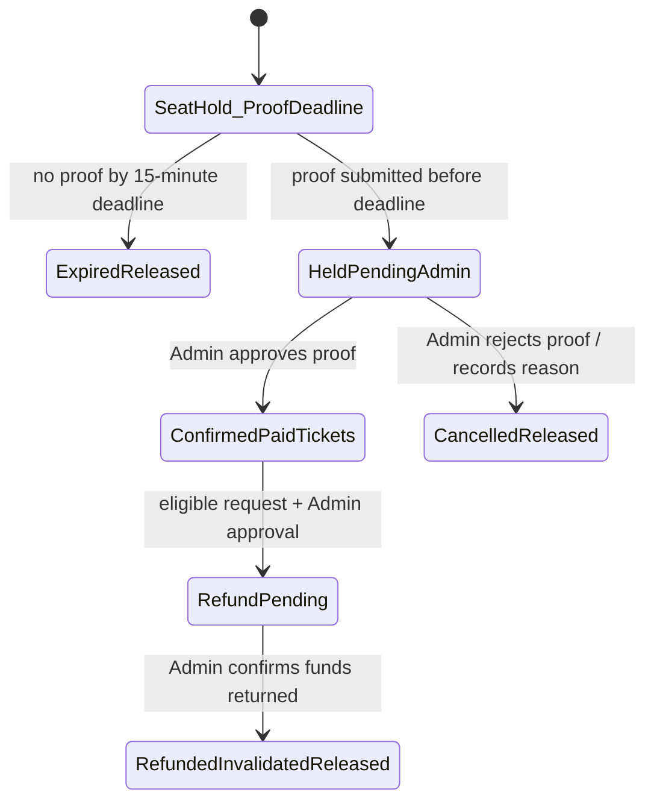

# Workflows and state machines

This document formalizes approved business rules. Where details are not decided, they are marked OPEN; the local build must not invent business policy. The Master Build Prompt authorizes local implementation subject to those gates.

## Online booking

Rules:

1. Server atomically holds all selected seats; starts 15-minute clock for proof upload.
2. If no proof is submitted by expiry, booking expires and all held seats release. Customer starts a new booking.
3. Timely proof upload moves to `Held / Pending Admin Review`; no auto-expiration, even if review lasts days. It remains held until Admin decision.
4. Proof is not payment confirmation. Only Admin can approve/reject. Approval marks paid/confirmed and issues each ticket, combined PDF and delivery. Rejection cancels/releases immediately and records reason, Admin and time; no ticket.
5. No partial payment. Use only uploaded proof authorized for that booking. Prevent replacement/replay/duplicate decisions from changing a terminal state.

**OPEN:** exact deadline boundary and accepted timestamp semantics (e.g. whether upload commit must arrive strictly before `expiresAt`); proof file limits and acceptable proof criteria; Admin notification/escalation and decision SLA; handling duplicate/replacement uploads; recovery when Admin approval is later found erroneous. Options must be decided by owner/technical review without weakening the indefinite hold rule.

## Group booking: separate 25-minute clock

```mermaid
stateDiagram-v2
  [*] --> GroupSeatHold_Running
  GroupSeatHold_Running --> GroupSeatHold_Paused: discretionary discount/comp request pending
  GroupSeatHold_Paused --> GroupSeatHold_Running: Admin approves or rejects; resume remaining time
  GroupSeatHold_Running --> GroupExpiredReleased: remaining 25-minute time elapses
  GroupSeatHold_Running --> GroupCashConfirmed: own Officer confirms full Cash received
  GroupSeatHold_Running --> GroupInstaProofPending: Officer uploads InstaPay proof
  GroupInstaProofPending --> GroupConfirmedTickets: Admin approves proof before remaining time expires
  GroupInstaProofPending --> GroupCancelledReleased: Admin rejects proof
  GroupInstaProofPending --> GroupExpiredReleased: remaining timer expires
  GroupCashConfirmed --> GroupConfirmedTickets: booking otherwise complete
```

Rules:

- Group starts at 10 tickets and uses an individual Booking Officer account.
- Holds last 25 minutes. A pending discretionary discount/complimentary request pauses elapsed time; decision resumes with remaining time. InstaPay proof review does not pause timer.
- Cash is confirmable only by the Booking Officer acting on their own booking and only for the full amount. InstaPay requires proof plus Admin approval. Full payment only.
- Rejected InstaPay proof cancels/releases immediately. If remaining time expires before group booking completes, release seats. No partial payment or issued paid tickets before full confirmation.
- Officer can see all bookings and financial reports; cannot export and cannot edit another Officer's booking without Admin permission.

**OPEN:** exact definition of “booking complete” at timer boundary, including whether final seat/payment confirmation must be committed strictly before expiry; how long an Admin may take on group proof; if admin rejection happens after expiry, record rejection and preserve already-released state; full cash handling evidence; upload replacement proof. Do not let a late Admin action revive an expired reservation.

## Quantity discount and complimentary tickets

Approved tier applies automatically to eligible online and group booking count (including complimentary tickets) and discounts paid tickets only: under 30: EGP 0; 30–59: EGP 10 each paid ticket; 60–89: EGP 20; 90–119: EGP 30; no 120+ tier.

Discretionary Booking Officer discount/free-ticket request → pending Admin decision (group timer pauses) → approval applies requested comp/discount or rejection leaves none applied; then resume remaining hold time. Record requester/approver/reason/timestamp.

Team member entitlement: one ordinary comp ticket per person across the entire production run. Admin-managed member list. Officer selects member and requests. On Admin approval and issue, consumed even if unused. Admin may directly issue ordinary guest comp tickets. Every comp uses an ordinary seat, ticket and unique QR. VIP remains separate.

**OPEN:** whether a team member comp needs a valid seat hold before request or only at issue; resolving duplicate/member identity; whether one booking may mix different discretionary comps. Do not create a 120+ discount tier.

## VIP invitation

Admin creates named invitation and contact/delivery; no cap, seat or performance binding. Each invitation has unique QR and active/revoked status. A scan for a performance logs invitation, performance, time and scanning account. Use on another performance is permitted; Admin revocation denies future scans.

**OPEN:** whether same invitation can be scanned more than once for the same performance; options include allow every scan, or allow one admission per invitation/performance. Do not apply ordinary-ticket duplicate rule across performances or impose a numerical cap.

## Refund and seat release

Customer cancellation request at least 48 hours before start may be eligible; below that cutoff no customer-initiated refund. Theatre cancellation creates full refund entitlement. Postponement allows retain or full refund with Admin-set deadline. All cancellations/refunds require Admin approval; refund is processed manually.

States: `Requested → AdminApproved → ManualRefundPending → AdminConfirmsReturned → Ticket/QR invalidated + seats released`. Until Admin confirms returned funds, seats stay unavailable and admission state is not silently changed. Record reason, actor, timestamps, payment information and refund evidence.

**OPEN:** failed/partial manual refund, gateway/bank fees and processing time; postponement notice and deadline policy; a request after cutoff may the customer cancel admission without refund; exact seat reassignment when retained for rescheduled date. Do not invent a remedy.

## Production changes after sales begin

Admin requests change → record before/after and reason → assess affected holds, confirmed bookings, payments, seat mapping and issued tickets → owner/authorized Admin decision on customer remedy and communications → apply controlled versioned update → audit. Do not silently rewrite or automatically migrate orders/tickets for date, venue, seat map or price changes.

Options and rules per change type (including whether sale pauses, refund entitlement, customer choice and re-seat mapping) are OPEN. Dates are fixed and normally not added/removed after setup.

## QR scanning and race conditions

Ordinary scan: `Issued → Atomic redemption → Admitted`; later/concurrent scan yields `Already used`; revoked/refunded/cancelled yields `Cancelled`; unknown/forged/wrong performance yields `Invalid`. Server validates every scan and commits one conditional state update so two devices cannot admit the same ordinary ticket. Scanner display updates all clients immediately via shared server state/polling strategy chosen at design time.

VIP scan checks active invitation and performance use policy; each use is logged. Reuse on other performances allowed; same-performance rule OPEN.

Failure cases: two customers select same seat; proof upload races expiry; Admin approval races an expiry worker; group timer pauses/resumes while expiry fires; Cash confirmation races expiry; multiple scanners scan ordinary QR simultaneously; QR revocation races scanning; DB/storage/email/WhatsApp outage; backup restore. Use serializable/conditional transactions or equivalent constraints and idempotent transitions. If scan server unavailable, deny entry and escalate to Admin; offline admission is out of scope.
