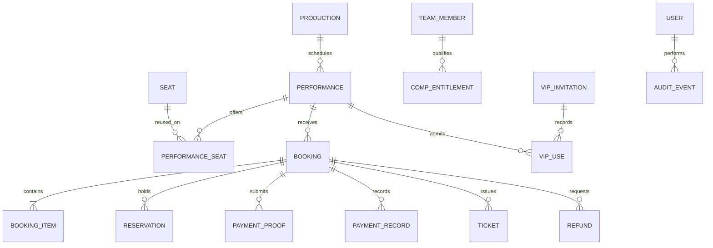

# Detailed data model and permission design

This is a design reference for local implementation, not a Prisma schema or migration. The owner-approved visual map references exist, but reconcile them to the canonical permanent seat manifest before seeding sale inventory.

## Proposed entities

| Entity | Important fields and relationships |
|---|---|
| `Production` | `id`, title, description, venue snapshot, publication state, created/updated actor/time, version. One configured play per setup. |
| `Performance` | `id`, productionId, startsAt, fixed schedule, status/sales state, venue snapshot/version. Unique production+startsAt only if owner confirms no legitimate duplicated slots. All fixed performances become bookable when Production published. |
| `Seat` | `id`, unique permanent `seatCode`, area, row/side/number, layout coordinates, category (ordinary/photography/blocked), active flag. Counts/codes imported only from approved physical map. VIP never represented as Seat. |
| `PerformanceSeat` | `performanceId`, `seatId`, sellable/blocked state or computed status, active allocation relation. Unique `(performanceId, seatId)`. Ordinary price is production-wide uniform and price snapshot stored at booking line; photography cannot be sellable. |
| `Booking` | opaque public ref, channel, performanceId, owner/organizer name and mobile, optional email, delivery choices, ticket count, affiliation and optional actorId, lifecycle, creator userId, times and total snapshots. Online 1–9; group 10+. |
| `BookingItem` / `BookingSeat` | bookingId, seatId, performanceId, item type ordinary/comp, paid amount/quantity discount, exact price/totals. Enforce no duplicate active `(performanceId, seatId)`. |
| `Reservation` | bookingId, state, channel, createdAt, proofDeadline (online), remainingDuration/pausedAt/pauseReason/resumeAt (group), terminal timestamps. Online pending proof review has no expiry. Group timer pauses only for pending discount/comp request. |
| `PaymentProof` | bookingId, private object key, content type/size/digest, submittedBy/time, review state, reviewedBy/time, decision/reason, evidence notes. Upload is not paid status. |
| `PaymentRecord` | bookingId, Cash/InstaPay, full amount/currency, state, confirmedBy/time, proof/review relation, cash receipt reference. Enforce full-only collection. |
| `DiscountDecision` | bookingId, qualifyingCount, approved tier, discountPerPaidTicket, total, requestedBy/approvedBy/time/reason for discretionary change. Preserve base tier calculation separately from exception. |
| `TeamMember` | Admin-managed roster and active state. No invented names. |
| `CompEntitlement` | teamMemberId, productionId, state available/requested/issued, ordinary ticketId, request/approval/issue actor/time. Unique one consumed entitlement per member+production. |
| `VIPInvitation` | recipient name/contact, delivery channels, unique token hash, active/revoked state, issuedBy/time, revokedBy/time. No seat/performance FK and no cap. |
| `VIPUse` | invitationId, performanceId, scannedAt, scannerUserId, result/device. Index invitation+performance+time; do not impose uniqueness on invitation+performance until same-performance rule decided. |
| `Ticket` | bookingId, bookingItemId, seatId, performanceId, unique opaque token hash, issuedAt, revokedAt/reason, redemption state/time/scanner. Ordinary one ticket per paid/comp seat. VIP invitation uses separate entity/token. |
| `TicketScan` | ticketId/token lookup, performanceId, scannerUserId, time, result, request id/device metadata. Append-only; ordinary successful redemption unique. |
| `Refund` | bookingId/payment record, reason/type, amount/currency, eligibility, requested/approved actor/time, manual processing evidence/status, returnedConfirmedBy/time. Seat release and ticket invalidation occur only after returned confirmation. |
| `DeliveryAttempt` | booking/ticket/invitation, channel, destination reference (minimized), attempt time, provider id/status/error, retry count; no plaintext secrets in logs. |
| `CustomerTrackingLink` | bookingId, token hash, issuedAt, expiry/revocation, lastUsedAt. High-entropy random secret; no mobile-only lookup. |
| `IdentityDocument` | bookingId, required-count linkage/status, private file object key, metadata/digest, receivedBy/time, retention/deletion state. Group/member association minimized; exact association OPEN pending legal/privacy review. |
| `User` / `Role` | Individual credentials/identity-provider subject, active, role, created/deactivated timestamps. Staff roles: SUPER_ADMIN, ADMIN, BOOKING_OFFICER, SCANNER. CUSTOMER is guest-only and has no login. |
| `AuditEvent` | actorId, action, entityType/id, occurredAt, reason, change summary/before-after safe fields, correlation ID. Never file bytes, raw tracking/QR tokens or passwords. |
| `ProductionChange` | production/performance/venue/map/price version, before/after references, reason, actor/time, impact assessment and resolution records. |
| `ArchiveProduction` | Historical informational title, years, source/description, poster reference and ordering. Not connected to bookable Performance or seat inventory. |
| `HistoricalCastRecord` | ArchiveProduction/character, actor or performer names, source/order; separate from live per-Performance cast assignments. |
| `Actor` / `Character` / `CastAssignment` | Actor and role records; each assignment belongs to a specific Performance so double-casting and alternate assignments do not affect other dates. |
| `ProductionCredit` / `CreditContributor` | Production/archive item, custom department title, ordered contributors; kept separate from cast. |

## Main relationships

## Constraints and indexes

- Unique permanent `Seat.seatCode`; unique `PerformanceSeat(performanceId, seatId)`.
- Transactional conditional uniqueness for active allocation per performance/seat. New performance does not conflict with an old one.
- Unique booking public reference, ticket token hash, VIP token hash, tracking-link hash, and provider/delivery idempotency IDs within provider scope.
- Index reservation state/deadline, review queue state/submittedAt, bookings by performance/createdAt/channel/officer/affiliation, ticket performance/state, scan token/time, refunds status, and audit time/entity.
- Restrict file keys and document fields from API serialization/report export. Store exact money in minor units or exact decimal + explicit currency.
- Online timely proof changes reservation out of expiring state; never expire `Pending Admin Review`. Group pause/resume stores remaining seconds consistently and prevents duplicate pause periods.
- Do not enforce a VIP one-use-per-performance unique key until owner resolves that policy.

## Role/action matrix

| Action | Customer (guest) | Scanner | Booking Officer | Admin | Super Admin |
|---|---|---|---|---|---|
| Browse public team/archive/production content | Allowed | Allowed | Allowed | Allowed | Allowed |
| Create online booking / own tracking access | Allowed, no account | No | No | No | No |
| Create group booking (10+) and hold seats | No | No | Allowed | Allowed | Allowed |
| View all bookings and financial reports | Own booking only | No | Allowed | Allowed | Allowed |
| Export reports | No | No | No | Allowed | Allowed |
| Edit own group booking before payment | No | No | Allowed by state | Allowed | Allowed |
| Edit another Officer's booking | No | No | No, absent Admin permission | Allowed | Allowed |
| Confirm full Cash for own group booking | No | No | Allowed | Allowed | Allowed |
| Upload group InstaPay proof | No | No | Allowed | Allowed | Allowed |
| Approve/reject InstaPay proof | No | No | No | Allowed | Allowed |
| Request discount/team comp | No | No | Allowed; cannot self-approve | May approve; may directly issue guest comp | Allowed |
| Approve discount/Officer-requested comp | No | No | No | Allowed | Allowed |
| Manage cast and credits | No | No | No | If authorized | Allowed |
| Scan/validate ticket or VIP invitation | No | Allowed; admission data only | Only if separately granted | Allowed | Allowed |
| Manage seats, bookings, payment, refund, VIP and reports | No | No | Group workflow only | Operational rights | Full rights |
| Manage Admin/Super Admin accounts or reserved critical settings | No | No | No | No | Allowed under secure ownership controls |
| Manage Booking Officer/Scanner accounts | No | No | No | OPEN; deny by default | Allowed |

Report export is Admin/Super Admin only even though Booking Officers can see financial detail. Scanner receives admission-only access and cannot reach payment proofs, customer exports or management dashboards. Admin delegation for Booking Officer/Scanner account management remains unresolved; deny by default until decided.

## OPEN design inputs

Official seat manifest, identity document association, exact auth provider/session model, admin recovery/MFA, image access roles, retained history, status enums, same-performance VIP reuse, report fields/masking, exact database locking design, tracking-link recovery, manual refund evidence and field retention require owner/legal/technical review. No migration or schema is created by this document.
